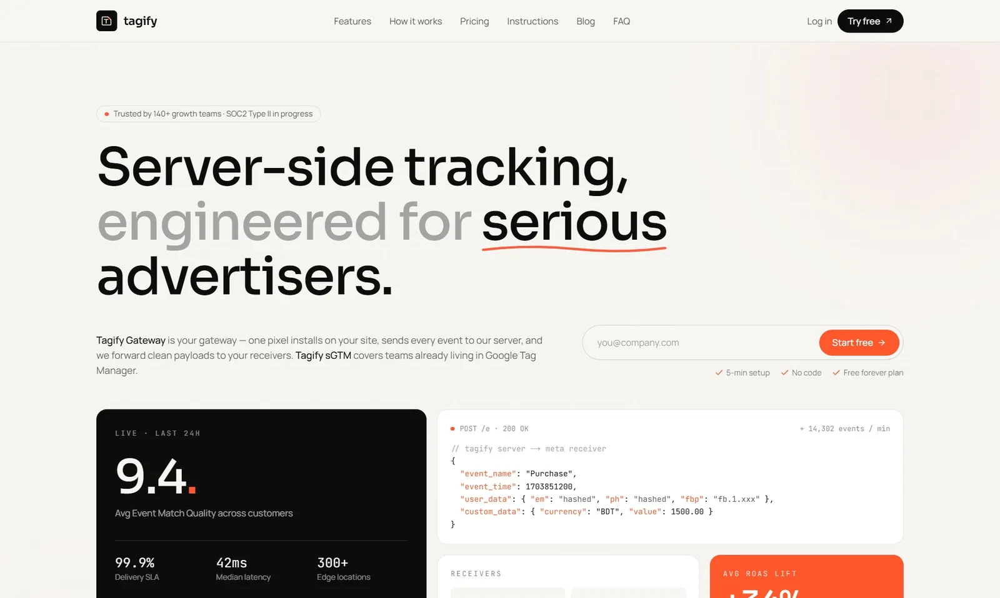
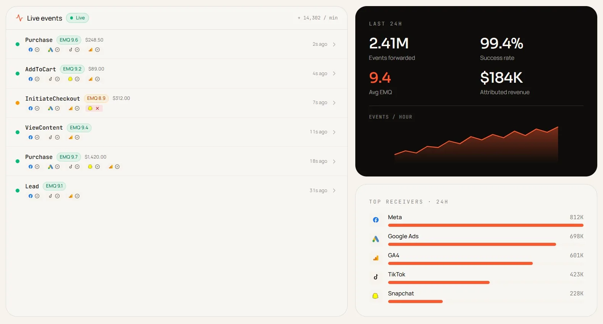

# Tagify

Marketing site and customer dashboard for **Tagify**, a server-side tracking platform. Advertisers route their
conversion events through a Tagify Gateway or a hosted server-side GTM container, then see in one dashboard that
every event reached GA4, Google Ads, Meta and TikTok.

**Live demo:** [tagify-brown.vercel.app](https://tagify-brown.vercel.app)

## Features

**Accounts and security**
- Sign up and sign in with email and password, Google or GitHub, with password reset
- Sessions checked on the server for every dashboard page and API route
- Admin area for managing users and plans, limited to admin accounts

**A working demo from the first sign-in**
- Every new account gets a seeded workspace: a gateway with destinations, 30 days of analytics, a running
  sGTM container and a live event stream

**Tracking Gateway**
- Destinations (receivers) for Meta Conversions API, Google Ads and TikTok, added and removed from the dashboard
- Google Ads connection status for each gateway
- Analytics per gateway: events over time, delivery by destination and match quality
- Live events page that streams new events as they arrive

**Hosted sGTM containers**
- Create and manage server-side Google Tag Manager containers, each on its own custom domain with DNS checks

**Dashboard essentials**
- Notifications, workspace settings and plan limits
- Fast, responsive UI with charts, dialogs, toasts and date-range pickers

**Marketing site**
- Landing, features, how it works, pricing, FAQ, blog, contact, affiliate program and legal pages

## Technology

| Area | Tools |
| --- | --- |
| Framework | Next.js 16 (App Router, Route Handlers, Cache Components), React 19, TypeScript |
| Authentication | Better Auth (email and password, Google OAuth, GitHub OAuth) |
| Database | MongoDB, with aggregation pipelines for analytics |
| Data fetching and validation | TanStack Query, Zod |
| UI | Tailwind CSS v4, Radix UI, Recharts, Lucide icons, Sonner toasts |
| Hosting | Vercel |

## How it's built

- **Live events on serverless hosting.** The live page is a Server-Sent Events stream that checks MongoDB for new
  events every few seconds, so it works on Vercel without a separate WebSocket server.
- **Analytics without a data warehouse.** Charts are computed with MongoDB aggregation pipelines over the events
  collection, indexed by workspace and time.
- **Demo data on sign-up.** A database hook on account creation seeds the demo workspace.
- **Two layers of access control.** A quick cookie check redirects signed-out visitors, and every dashboard layout
  and API route validates the session on the server. Admin routes also check the user's role.

In this public version, container provisioning, DNS checks, OAuth connections and delivery to ad platforms are
simulated, so the demo is safe to explore.

---

Built by [Khairul Islam Bappy](https://bappycode.vercel.app) · [GitHub](https://github.com/bappycode) ·
[LinkedIn](https://www.linkedin.com/in/khairul-islam-bappy/)
